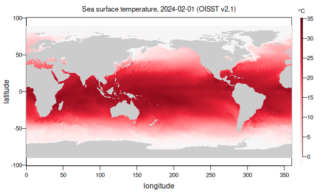

<!-- Precomputed: edit tabularberg.Rmd.orig, then run vignettes/precompute.R
     (needs the network). tabularberg.Rmd is generated. -->


An Icechunk repository holds array data together with versioned,
transactional metadata: which chunks exist, where their bytes live, and
how the arrays have changed over time. tabularberg reads that metadata
directly, so you can ask questions of a store as SQL tables before
deciding which data to fetch.

This vignette uses a public store with no credentials: 44 years of NOAA
OISST v2.1 daily sea surface temperature. Each chunk is a virtual
reference to a byte range in one of NOAA's netCDF files on AWS.


``` r
library(tabularberg)
library(DBI)

oisst <- "https://data.source.coop/ausantarctic/ausantarctic-scratch/oisst/oisst-v2.1-daily/icechunk"
con <- dbConnect(Icechunk(), oisst)
con
#> <IcechunkConnection> branch main @ 0MYSJ33RPR7A5VJJE040
dbListTables(con)
#>  [1] "meta"      "arrays"    "sources"   "branches"  "tags"      "ancestry"  "nodes"     "refs_anom"
#>  [9] "refs_err"  "refs_ice"  "refs_lat"  "refs_lon"  "refs_sst"  "refs_time" "refs_zlev"
```

## What is in the store

`arrays` has one row per array, in the
[byterefs](https://github.com/mdsumner/raad.virtualize) layout: kind,
dimensions, shape, chunking and data type.


``` r
dbGetQuery(con, 'SELECT "array", kind, dims, shape, chunks, dtype FROM arrays')
#>   array  kind                        dims              shape         chunks dtype
#> 1  anom  data ["time","zlev","lat","lon"] [16482,1,720,1440] [1,1,720,1440]   <i2
#> 2   err  data ["time","zlev","lat","lon"] [16482,1,720,1440] [1,1,720,1440]   <i2
#> 3   ice  data ["time","zlev","lat","lon"] [16482,1,720,1440] [1,1,720,1440]   <i2
#> 4   lat coord                     ["lat"]              [720]          [720]   <f8
#> 5   lon coord                     ["lon"]             [1440]         [1440]   <f8
#> 6   sst  data ["time","zlev","lat","lon"] [16482,1,720,1440] [1,1,720,1440]   <i2
#> 7  time coord                    ["time"]            [16482]        [16482]   <f8
#> 8  zlev coord                    ["zlev"]                [1]            [1]   <f8
```

`nodes` is Icechunk's own view, and `ancestry` the commit history of the
branch.


``` r
dbGetQuery(con, "SELECT path, shape, num_chunks FROM nodes WHERE type = 'array'")
#>    path            shape  num_chunks
#> 1 /anom 16482,1,720,1440 16482,1,1,1
#> 2  /err 16482,1,720,1440 16482,1,1,1
#> 3  /ice 16482,1,720,1440 16482,1,1,1
#> 4  /lat              720           1
#> 5  /lon             1440           1
#> 6  /sst 16482,1,720,1440 16482,1,1,1
#> 7 /time            16482           1
#> 8 /zlev                1           1
dbGetQuery(con, "SELECT snapshot_id, written_at, message FROM ancestry")
#>            snapshot_id               written_at
#> 1 0MYSJ33RPR7A5VJJE040 2026-11-02T06:11:32.973Z
#> 2 1CECHNKREP0F1RSTCMT0 2026-11-02T06:11:32.662Z
#>                                                                 message
#> 1 mdim-refs flat store /v/work/oisst-v2.1-daily/out/flat, target public
#> 2                                                Repository initialized
```

## Chunk references as rows

Each array also has a `refs_<array>` table with one row per chunk.
`dim_0`, `dim_1`, … are the chunk's indices, and `path`, `offset` and
`size` give the byte range it points to. `sst` is chunked one day at a
time, so `dim_0` is the day number since 1981-09-01:


``` r
day <- as.integer(as.Date("2024-02-01") - as.Date("1981-09-01"))
dbGetQuery(con, sprintf('SELECT dim_0, path, "offset", size FROM refs_sst WHERE dim_0 = %d', day))
#>   dim_0
#> 1 15493
#>                                                                                                                                 path
#> 1 https://noaa-cdr-sea-surface-temp-optimum-interpolation-pds.s3.amazonaws.com/data/v2.1/avhrr/202402/oisst-avhrr-v02r01.20240201.nc
#>   offset   size
#> 1  47587 671857
```

That query reads only the chunk references it needs. When the `WHERE`
clause narrows `dim_k` with plain comparisons, tabularberg fetches just that
slab of chunks, and on stores with split manifests only the manifests
covering it. The SQL engine still applies the full predicate, so results
are the same as reading the whole table. Joins are narrowed too. For
example, does each day's `ice` chunk come from the same file as its
`sst` chunk?


``` r
dbGetQuery(con, "
  SELECT count(*) AS days, sum(s.path = i.path) AS same_file
  FROM refs_sst s JOIN refs_ice i ON s.dim_0 = i.dim_0
  WHERE s.dim_0 BETWEEN 15462 AND 15827")
#>   days same_file
#> 1  366       366
```

The filter on `s.dim_0` carries across `s.dim_0 = i.dim_0`, so both
tables are read for that year only.

Whole-table questions work as well, such as how much netCDF the `sst`
array references:


``` r
dbGetQuery(con, "SELECT count(*) AS chunks, sum(size) / 1e9 AS gigabytes FROM refs_sst")
#>   chunks gigabytes
#> 1  16482  11.03335
```

`sources` lists every referenced file. It reads every array's references,
so later queries are answered from those cached tables.


``` r
src <- dbReadTable(con, "sources")
nrow(src)
#> [1] 16482
basename(src$source[c(1, nrow(src))])
#> [1] "oisst-avhrr-v02r01.19810901.nc" "oisst-avhrr-v02r01.20261016.nc"
```

## dbplyr

The connection works with dbplyr. Filters on `dim_k` are pushed down in
the same way.


``` r
library(dplyr, warn.conflicts = FALSE)
refs <- tbl(con, "refs_ice")
q <- refs |>
  filter(dim_0 >= 15462, dim_0 < 15462 + 366) |>
  summarise(chunks = n(), megabytes = sum(size, na.rm = TRUE) / 1e6)
show_query(q)
#> <SQL>
#> SELECT COUNT(*) AS `chunks`, SUM(`size`) / 1000000.0 AS `megabytes`
#> FROM `refs_ice`
#> WHERE (`dim_0` >= 15462.0) AND (`dim_0` < (15462.0 + 366.0))
collect(q)
#> # A tibble: 1 × 2
#>   chunks megabytes
#>    <int>     <dbl>
#> 1    366    20.995
dbDisconnect(con)
```

SQL runs on an in-memory SQLite copy by default. Use
`dbConnect(Icechunk(), oisst, sql = "duckdb")` for large reference tables:
they are then handed to DuckDB as Arrow record batches built in Rust. In
DuckDB `offset` and `array` are reserved words, so quote them as above.
`ic_refs_arrow()` returns the same tables as an Arrow stream directly.

## Time travel on a local catalogue

The public store is read-only and has a single commit. To see versioning
at work, copy its references into a local repository. This copies only
references: the chunks stay on NOAA's bucket, and authorising that
container lets the local repository read them.


``` r
noaa <- "https://noaa-cdr-sea-surface-temp-optimum-interpolation-pds.s3.amazonaws.com/"
pub <- ic_session_readonly(ic_repo_open(oisst), branch = "main")
local <- file.path(tempdir(), "oisst-catalogue")
repo <- ic_repo_from_byterefs(ic_to_byterefs(pub), local, authorize = noaa,
                              message = "copy of the public OISST references")
ic_tag_create(repo, "public", ic_branches(repo)$snapshot_id[1])
```

Next, add a curated array `sst_2024` holding the 366 days of 2024. Its rows
are written in a transaction, which becomes one Icechunk commit.


``` r
cg <- dbConnect(Icechunk(), local, authorize = noaa)
a <- dbReadTable(cg, "arrays")
y <- a[a$array == "sst", ]
y$array <- "sst_2024"
y$shape <- "[366,1,720,1440]"
d0 <- as.integer(as.Date("2024-01-01") - as.Date("1981-09-01"))
r <- dbGetQuery(cg, sprintf("SELECT * FROM refs_sst WHERE dim_0 BETWEEN %d AND %d", d0, d0 + 365))
r$dim_0 <- r$dim_0 - d0

dbBegin(cg)
dbAppendTable(cg, "arrays", y)
#> [1] 1
dbAppendTable(cg, "refs_sst_2024", r[c("dim_0", "dim_1", "dim_2", "dim_3", "path", "offset", "size")])
#> [1] 366
dbCommit(cg, "sst_2024: the days of 2024 as their own array")
dbGetQuery(cg, "SELECT snapshot_id, message FROM ancestry")
#>            snapshot_id                                       message
#> 1 SJ078RSTHBV96XGJ6S2G sst_2024: the days of 2024 as their own array
#> 2 M1W1NR8213ECB56VJTTG           copy of the public OISST references
#> 3 1CECHNKREP0F1RSTCMT0                        Repository initialized
```

The tag still sees the repository as it was before:


``` r
then <- dbConnect(Icechunk(), local, tag = "public", authorize = noaa)
"refs_sst_2024" %in% dbListTables(then)
#> [1] FALSE
"refs_sst_2024" %in% dbListTables(cg)
#> [1] TRUE
dbDisconnect(then); dbDisconnect(cg)
```

Connections can also pin a `snapshot`. Tag and snapshot connections are
read-only.

## Decoding a slab

The tables say where the bytes are. To decode them, hand an Icechunk
session to [pizzarr](https://github.com/zarr-developers/pizzarr).
`ic_pizzarr_store()` wraps a session as a pizzarr store, so pizzarr's
R code reads it. These chunks use netCDF-4's shuffle and zlib codecs,
which pizzarr's R decoder gains in the
[mdsumner/pizzarr](https://github.com/mdsumner/pizzarr) fork (branch
`icechunk-handoff`). That fork also has `IcechunkStore`, which reads
through its Rust (zarrs) backend.


``` r
s <- ic_session_readonly(ic_repo_open(local, authorize = noaa), branch = "main")
z <- pizzarr::zarr_open(ic_pizzarr_store(s), mode = "r", path = "sst_2024")
i <- 32L   # 2024-02-01
x <- z$get_item(list(pizzarr::slice(i, i), pizzarr::slice(1L, 1L),
                     pizzarr::slice(1L, 720L), pizzarr::slice(1L, 1440L)))$data
at <- z$get_attrs()$to_list()
sst <- x[1, 1, , ]
sst[sst == at[["_FillValue"]]] <- NA
sst <- sst * at$scale_factor
range(sst, na.rm = TRUE)
#> [1] -1.80 31.89

lon <- seq(0.125, 359.875, by = 0.25)
lat <- seq(-89.875, 89.875, by = 0.25)
pal <- hcl.colors(64, "Reds 3", rev = TRUE)
lim <- c(-2, 35)
layout(matrix(1:2, 1), widths = c(9, 1))
par(mar = c(3, 3, 2, 0.5), mgp = c(1.8, 0.5, 0), las = 1, cex.axis = 0.8)
plot(NA, xlim = c(0, 360), ylim = c(-90, 90), asp = 1, xaxs = "i", yaxs = "i",
     xlab = "longitude", ylab = "latitude",
     main = "Sea surface temperature, 2024-02-01 (OISST v2.1)", font.main = 1, cex.main = 0.95)
rect(0, -90, 360, 90, col = "grey80", border = NA)   # land and missing: grey
image(lon, lat, t(sst), col = pal, zlim = lim, useRaster = TRUE, add = TRUE)
par(mar = c(3, 0.5, 2, 3))
image(1, seq(lim[1], lim[2], length.out = 64), t(seq_len(64)), col = pal, axes = FALSE, xlab = "", ylab = "", useRaster = TRUE)
axis(4); mtext("°C", side = 3, line = 0.3, cex = 0.8)
```

<div class="figure">

<p class="caption">plot of chunk sst-2024-02-01</p>
</div>

Only the one 2024-02-01 chunk was fetched: a single byte range from
`oisst-avhrr-v02r01.20240201.nc`.
